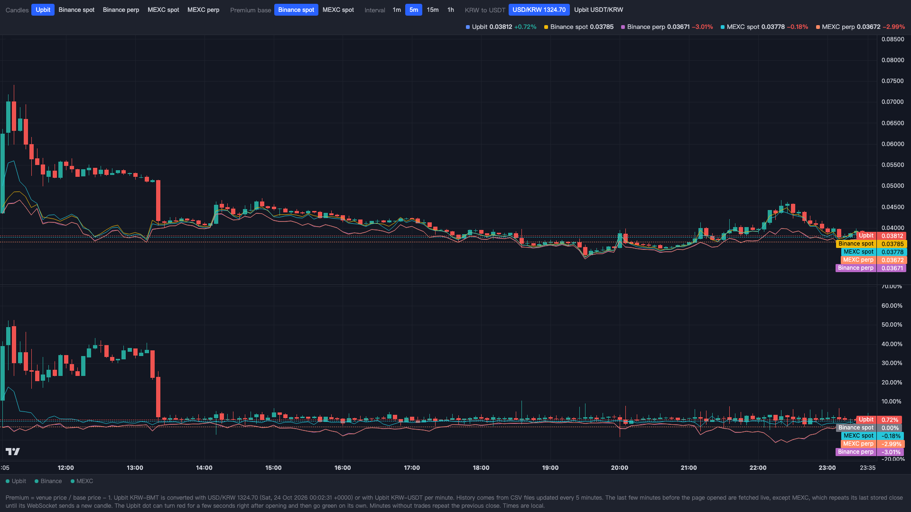

# upbit-premium-chart

[English](README.md) | [繁體中文](README.zh-TW.md) | [简体中文](README.zh-CN.md)

实时显示 BMT 在 Upbit 相对币安与 MEXC 的溢价。BMT 是 Bubblemaps 的代币。Upbit 用韩元报价，页面会换算成 USDT，和币安现货、币安 USDT 永续合约、MEXC 现货、MEXC USDT 永续合约画在一起。币安和 MEXC 从 BMT 在 Upbit 上线前两周开始画，看得到上币前的走势。Upbit 从上线开始。

历史数据以 CSV 存在这个 repo 的 `data` 分支，`collect.py` 每 5 分钟补一次。页面先读这些文件，一两秒就能打开，再实时补上最后几分钟，之后通过 WebSocket 与轮询持续更新。页面没有后端，也不含任何 API 密钥。

在线页面：https://yyu0310.github.io/upbit-premium-chart/



想在本地运行，把下面这段贴给 AI coding agent：

```
Clone https://github.com/yyu0310/upbit-premium-chart ，用任何静态文件服务器打开这个文件夹，例如 python3 -m http.server，再用浏览器打开 index.html。
```

## 页面内容

| 区块 | 功能 |
| --- | --- |
| Show | 取消勾选某家，那家就从上下两张图、右上数字、十字线说明里去掉。浏览器会记住选择。 |
| 上图 | Upbit、币安现货、币安合约、MEXC 现货、MEXC 合约的 USDT 价格。Candles 选哪家，哪家画成 K 线，其他画收盘线。Upbit 上线那根有箭头标记。 |
| 下图 | 各家相对溢价基准的溢价百分比。选中的那家不是基准时，它的溢价画成 K 线。 |
| Premium base | 溢价基准，可选币安现货或 MEXC 现货。币安没上的币改用 MEXC 现货。 |
| Interval | 1 分、5 分、15 分、1 小时 K 线，默认 15 分。 |
| KRW to USDT | Upbit 韩元价的换算方式：USD/KRW 汇率，或 Upbit 自己的 KRW-USDT 逐分钟价格。USDT 在韩国本身有溢价，所以两种算法结果不同。 |
| 右上数字 | 各家最新价格，以及相对基准的溢价。 |
| 十字线 | 光标所在那根 K 线的各家价格与溢价。 |

## 需求

- 新版浏览器。
- 网络能访问 `raw.githubusercontent.com`、`api.upbit.com`、`api.binance.com` 或它的镜像 `data-api.binance.vision`、`fapi.binance.com`、`contract.mexc.com`、`wbs-api.mexc.com`、`open.er-api.com`。
- 想自己运行数据收集程序：Python 3.9 以上，只用标准库。

## 快速开始

看图：
1. Clone 这个 repo。AI agent 可以代劳。
2. 用静态文件服务器打开文件夹，打开 `index.html`。AI agent 也可以代劳。

自己运行数据收集程序是可选的，页面默认读这个 repo 的 `data` 分支。
1. 把 `data` 分支 clone 到独立文件夹：`git clone -b data https://github.com/yyu0310/upbit-premium-chart data-clone`。AI agent 可以代劳。
2. 定时运行 `python3 collect.py --repo data-clone`，例如每 5 分钟。加 `--no-push` 只写 CSV、不推送。
3. 要推送的话，这份 clone 需要你 fork 的写入权限。deploy key 或 token 请自己创建，不要交给 AI agent。
4. 把 `index.html` 程序开头的 `RAW` 改成指向你 fork 的 `data` 分支。

## 数据来源

| 交易所 | 历史 | 实时更新 |
| --- | --- | --- |
| Upbit KRW-BMT | CSV，最后一行之后用 REST 补 | WebSocket `candle.1m` |
| Upbit KRW-USDT | CSV，最后一行之后用 REST 补 | WebSocket `candle.1m` |
| 币安现货 BMTUSDT | CSV，再用 REST K 线补 | REST 每 2 秒轮询 |
| 币安合约 BMTUSDT | CSV，再用 REST K 线补 | REST 每 2 秒轮询 |
| MEXC 现货 BMTUSDT | 只有 CSV | WebSocket，protobuf 格式 |
| MEXC 合约 BMT_USDT | 只有 CSV | WebSocket `sub.kline` |
| USD/KRW | `open.er-api.com`，加载时获取一次 | 不更新，来源每天只更新一次 |

每个 CSV 的字段是 `time,open,high,low,close,volume,quote_volume`，`time` 是 K 线开盘时间，单位是 UTC 的 unix 秒。`volume` 是成交了多少个 BMT，`quote_volume` 是成交金额，Upbit 两个文件是韩元，其他是 USDT。只写已收盘的分钟。

溢价 = 该交易所价格 / 基准价格 - 1。

## 限制

- MEXC 的 REST API 没有 CORS 头，页面获取不到 CSV 最后一行到打开页面之间的那几分钟。这段 MEXC 用最后存下的收盘价补平线，等 WebSocket 推新 K 线才接上。空档通常不到 10 分钟：CSV 每 5 分钟更新，`raw.githubusercontent.com` 再缓存 5 分钟。
- 数据收集程序停掉的话，CSV 就不会更新。Upbit 和币安会改用 REST 获取比较长的一段，MEXC 的空档会变长。
- 币安和 MEXC 从 2026-10-10 UTC 03:05 开始，也就是 Upbit 上线前 14 天。Upbit 从 2026-10-24 UTC 03:05 上线开始。时间轴是本地时间。
- 图表最多每秒重画一次。两周的 1 分钟 K 线每家约 2 万根。
- Upbit 只有有成交的分钟才有 K 线，没成交的分钟用上一根收盘补一根平线。币安和 MEXC 每分钟都有。
- 用 KRW-USDT 换算时，Upbit 的高低点用同一分钟的 KRW-USDT 收盘价当分母，是近似值。
- 网页请求 Upbit 大约每 10 秒只能 1 次，所以 CSV 最后一行之后的 Upbit K 线要 10 到 20 秒才会出现。Upbit 的实时更新走 WebSocket，一打开就有。
- 刚打开页面时，Upbit 的状态灯可能红几秒，接着自己变绿。看起来是第一次 WebSocket 连接也被同一个限流挡下，3 秒后自动重连。数据不受影响。
- 币安在部分地区被封锁。访问不到溢价基准时整张图都不会画，请切换基准。访问不到其他交易所时，只有那家是空的。
- 页面请保持在前台，浏览器会降低后台页面的计时器频率。
- 图表用 jsDelivr 上的 [Lightweight Charts](https://github.com/tradingview/lightweight-charts) 5.0.8，并以 Subresource Integrity 哈希锁定版本。

本页内容不构成投资建议。

## 许可

MIT
